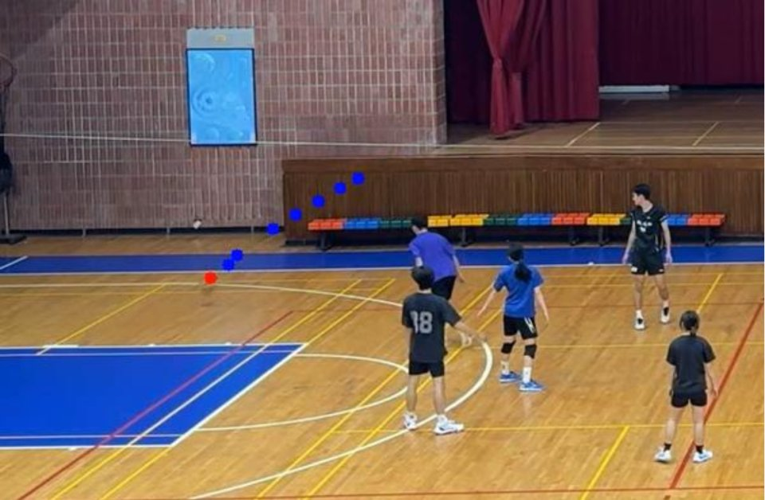
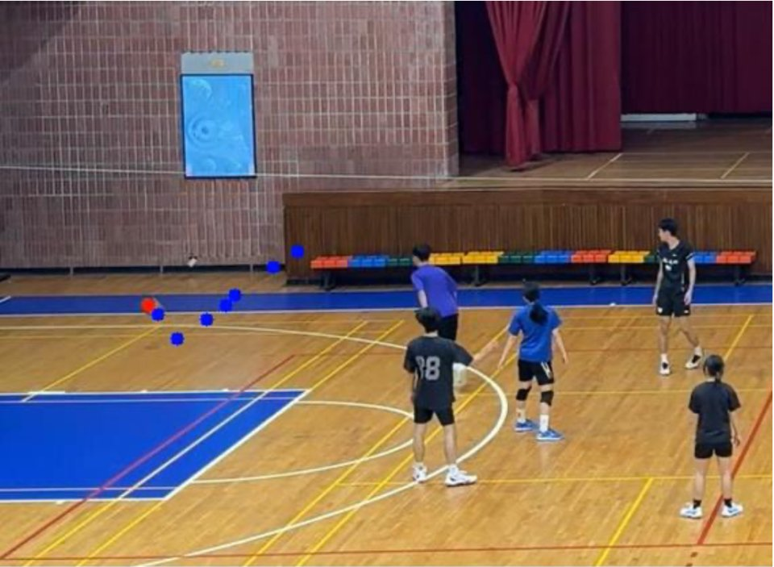

> **Archived.** Part of the NTOU senior capstone *Volleyball Match Analysis System Based on Deep Learning*.
> Its replacement, a learned court model with per-shot registration, is in [volleyball-analysis](https://github.com/DL-Volleyball-Analysis/volleyball-analysis); this repository is kept read-only as the record of the capstone version.

# Capstone: Ball Landing and IN/OUT | 落點與界內外判定

The capstone's landing pipeline: VballNet ONNX ball tracking, a court marked by four mouse clicks
(`click_court.py`), then landing detection and IN/OUT calls drawn on the video with a history panel.

| Ball track before the landing | Landing detected (red) |
|---|---|
|  |  |

## Limits, and what replaced it
- The court had to be clicked by hand for every camera position.
- Landings and IN/OUT used fixed pixel thresholds (for example a minimum image height of 640 px), so they only
  worked for the camera they were tuned on.

volleyball-analysis replaces both: a 14-point court keypoint model gives an image-to-court homography per camera
shot (0.49 m median error on held-out images), and landings are judged in court metres. See
[docs/results/court-keypoints.md](https://github.com/DL-Volleyball-Analysis/volleyball-analysis/blob/main/docs/results/court-keypoints.md).

## Contents
| Path | What it is |
|---|---|
| `src/inference_onnx_seq9_gray_v2.py` | ball detection with VballNet (ONNX) |
| `src/click_court.py` | four-point court annotation |
| `src/postprocess_inout_patched_v3.py` | landing detection and IN/OUT with the HUD overlay |

The VballNet ONNX models (from [fast-volleyball-tracking-inference](https://github.com/asigatchov/fast-volleyball-tracking-inference), MIT) were removed from the latest version to keep the repository light; they remain in the history at
[`b8e756a`](https://github.com/DL-Volleyball-Analysis/volleyball-court-detection/tree/b8e756a).

## Team
Liang Yu-Jia 梁祐嘉 (lead), Tsai Pei-Ying 蔡佩穎, Chung Chia-Hsin 鍾佳芯; advisor Professor Ting Pei-Yi 丁培毅.
Department of Computer Science and Engineering, National Taiwan Ocean University.
